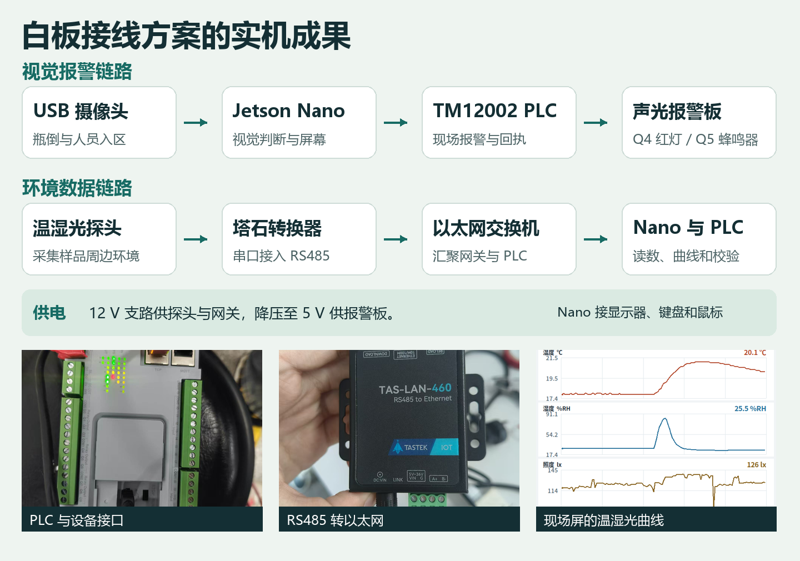
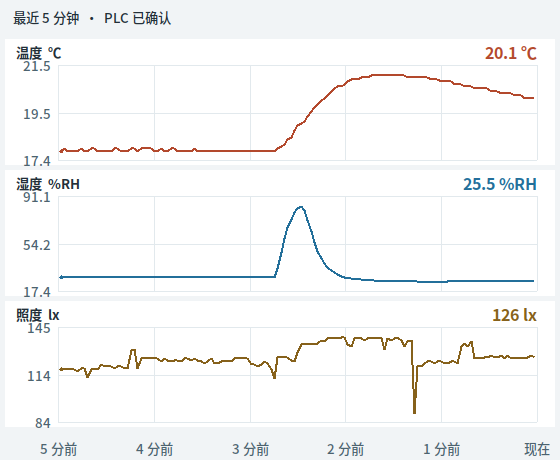

# 面向生物实验室的多源感知与 PLC 安全预警系统

天津商业大学 · 站在光里队 · 2026 新工科竞赛海康威视企业命题

一只脚跨过边界，警报应当响起。人已经走出去，警报凭什么解除？这两个问题决定了原型的分工。Jetson Nano 观察摄像头画面，给出“有人进入”或“已确认清场”的证据。TM12002 PLC 保存报警状态，控制声光输出，并把执行结果送回现场屏。

## 从论文到一张实验台

初赛论文《智能体协同管控系统的设计与实现》提出了多源感知、仲裁和控制执行。决赛选择生物实验室操作台，让评委能在同一处观察三件事：人是否踏入警戒区、样品瓶是否倾倒、台面周围的温度湿度和照度如何变化。前两项触发视觉告警，第三项呈现连续测量值。摄像头按场景切换，团队分别验证两种检测模式。

设计中最重要的一次取舍是取消对固定布景的依赖。比赛场地可能更换桌子、地面和胶带，操作员因此可以在实时画面上重新划区。样品瓶检测则先确认当前演示瓶直立，再由操作员启动本轮测试。PLC 收到清场、复位或失联时分别处理，避免把“看不见”解释为“安全”。

## 项目章节

| 章节 | 可以找到什么 |
| --- | --- |
| [一、硬件组装与接线](hardware/assembly.md) | 从传感器、网关、摄像头到 PLC 和洞洞板的实际连接关系，附端子和排线图 |
| [二、软件实现与协议](docs/implementation.md) | Nano 七个 Python 模块、视觉状态、寄存器约定、三路环境数据与复位握手 |
| [三、从首次上电到决赛的联调复盘](docs/retrospective.md) | 摄像头首帧偏暗、红框遮挡、背景误报、网络超时、持续鸣叫以及最终处理结果 |
| [四、部署与现场操作](docs/operation.md) | 桌面启动、空场标定、瓶倒测试、遮光看曲线、复位与退出 |
| [五、决赛汇报 PPT](presentation/final.pptx) · [评委问答与论文衔接](presentation/defense-qa.docx) | 六分钟汇报原稿、原型实测证据、技术取舍与后续计划 |

## 工程文件

- [Nano 源码](source/)可在 Jetson 桌面使用。运行 `bash install.sh` 安装桌面入口。有线网络和传感器地址按实际设备设置。
- [赛时安装包与 Windows 安装入口](contest-package/)保留赛时版本。源码目录另含赛后增加的启动日志和曲线按需加载，尚待 Nano 实机回归。
- [PLC 最终工程](plc/LabSafety-TM12002-SoftReset.project)配套 [Structured Text 程序](plc/LabSafetyAlarm.st) 和 [CODESYS 工程构建脚本](plc/build_tm12002.py)。使用 TM12002 对应设备包打开工程。

## 实测记录

一次采样读到 **20.1 °C、25.5% RH、126 lx**，界面显示 PLC 已确认。联调还记录了人员报警位翻转、瓶倒报警联动和软件复位回执。约两秒的环境采样周期和 20 ms 的 PLC 任务周期都是配置参数。跨场地误报率、端到端报警延迟、断电恢复及桌面启动稳定性仍需专项验证。论文里的 MQTT 仲裁和多工位 SCADA 追溯属于后续方案。

[按页查看六分钟讲解安排与现场演示分工](presentation/README.md)
