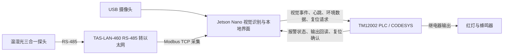

# 生物实验室安全预警系统 | 竞赛复盘

2026 年 11 月 · 天津商业大学站在光里队 · 新工科竞赛海康威视企业命题

本项目把初赛论文《智能体协同管控系统的设计与实现》落到一张实验台。团队用 Jetson Nano 识别人员踏入警戒区与样品瓶倾倒，用三合一探头采集温度、湿度和照度，再由 TM12002 PLC 执行报警、管理状态并回传结果。本页记录实物原型的搭建、联调和演示准备。此前的仿真项目另见 [PLC 工业数据采集与监控仿真系统](https://github.com/TEDAWYX/plc-monitor-sim)。

## 系统架构

- **人员警戒区**。操作者在实时画面沿边界点选顶点，采集空场作为底图。单脚进入形成有效前景时触发报警，确认清场后解除人员告警。程序排除空场中已有的红色胶带，用区外采样估计整体曝光变化。更换机位后重新划区和标定。
- **样品瓶倾倒**。用演示瓶瓶盖与标签的颜色和相对方向识别姿态。界面先确认直立，再由操作者启动本轮检测。目标持续丢失会取消本轮布防，降低背景相似物体导致的误触发。
- **环境监测**。Nano 经以太网转换器轮询 RS-485 三合一探头，解析温度、相对湿度和照度。近五分钟趋势图按约两秒的间隔采样，数据中断时留空。屏幕区分本地采样与 PLC 已确认的数据。
- **报警与复位**。PLC 检查视觉心跳，执行告警锁存和声光输出。Nano 发出带编号的复位请求，等待 PLC 回传对应编号和输出状态。复位结束本轮视觉检测。光或热输入仍报警时，蜂鸣器消音，红灯保留提示。

## 从搭建到现场演示

| 阶段 | 联调问题 | 处理与验证 |
| --- | --- | --- |
| 摄像头接入 | 设备名用错，预览失败，首帧偏暗 | 用 V4L2 核对设备节点，在 Nano 用 GStreamer 抓图，等曝光稳定后检查图像和机位。 |
| 人员入区 | 红框被遮住就失去跟踪，旧胶带曾引起误报 | 把物理红框改为可重划的虚拟区，用空场底图和胶带掩模判定前景。胶带版日志验证过人员位翻转，虚拟区版本按单脚入区和清场两步验收。 |
| 瓶倒检测 | 相似背景可能触发误报 | 增加直立确认、人工启动和丢失退出。联调中验证过瓶倒事件到 PLC 的报警链路。 |
| PLC 通信 | Nano 的以太网没有正确地址时，PLC 查询超时 | 检查网口状态、路由和 ARP，用有线接口访问 PLC，再做 Modbus 只读检查。恢复路由后读回 PLC 状态字。 |
| 报警解除 | 退出画面后持续报警，单看蜂鸣器难判断是哪路输入 | 分别检查报警来源、PLC 输出位与外部接线。增加一键复位和请求回执，在实机确认过 PLC 响应。 |
| 环境传感器 | 需要同时验证探头、转换器、Nano 和 PLC 的数据链 | 检查电源与 RS-485 接线，通过网关轮询，并对照显示值和 PLC 回读。一次实机画面读数为 20.1 °C、25.5% RH、126 lx，界面显示 PLC 已确认。 |
| 现场操作 | 浏览器预览、SSH 转发及端口占用增加了启动步骤 | 改为 Nano 本地桌面入口，把模式选择、划区、曲线和复位放在同一操作界面。按人员入区与退出、样品瓶倾倒与复位、遮光观察照度的顺序组织演示。 |

## 验证范围与后续

已完成 Nano 采集与识别、PLC 通信和报警状态回读、复位请求回执、温湿光实测与实时曲线。屏幕上的红灯、蜂鸣器状态来自 PLC 回读，实物报警器的动作取决于现场接线。赛前曾遇到 Nano 桌面入口闪退，当时 SSH 超时，故障根因和复发条件待用本机启动日志确认。PLC 也曾拒绝创建启动应用，完全断电后能否恢复软件复位版仍需复测。

论文中的 MQTT 黑板、多智能体证据仲裁和集中 SCADA 追溯属于下一阶段。先在一间实验室验证多工位部署，统一事件的点位、时间戳、状态和数据质量字段，同时记录误报率、漏报率、端到端报警延迟和离线恢复时间，再接入集中监控。每个工位保留本地 PLC 告警能力。

